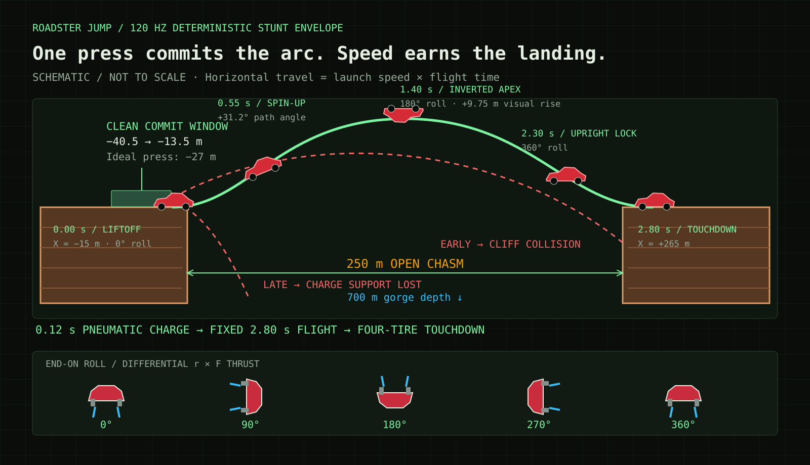
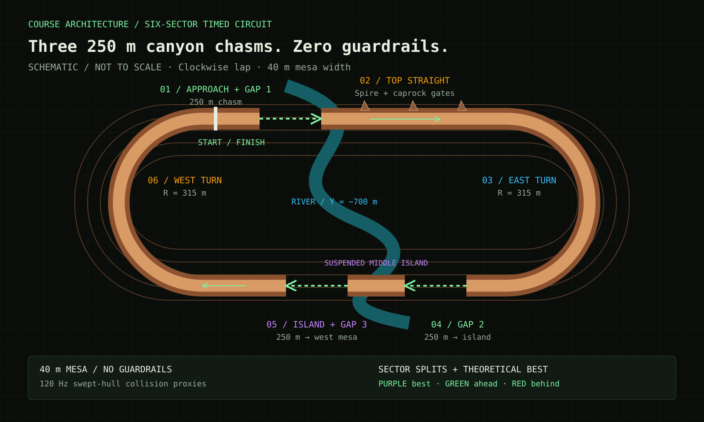

# Roadster Jump: Building a WebGPU Stunt Game Around the 2026 Tesla Roadster

*An authoritative 120Hz driving and cold-gas thruster simulation built from scratch with Blender MCP, Three.js WebGPU, and custom TSL shaders.*

When footage of the angular 2026 Tesla Roadster performing a cold-gas thruster "kickflip" — a full 360-degree longitudinal barrel roll mid-air — started circulating in mid-October, my first thought was: *what would it feel like if you actually had to time that jump across a 250-meter desert canyon?*

Not a cutscene. Not an animation that secretly stretches horizontal speed so you always hit the other side. A real browser game where you hold throttle up to 224 mph across a sunlit sandstone circuit, weave past monolith spires across six timed sectors, and commit to three 250-meter canyon leaps per lap. Press `Space` too early and your undercarriage clips the far cliff wall. Press a fraction too late and you run out of plateau during the 0.12-second pneumatic charge and drop 700 meters into the gorge.

The result is **Roadster Jump**, running live in the browser on Three.js WebGPU and Three.js Shading Language (TSL).

**[Play Roadster Jump ↗](https://roadsterjump.anshuldhawan.com/)** *(Keyboard `WASD` / Arrows + `Space`, or touch controls on mobile)*

---

## Interactive 3D Roadster & Shader Effects Lab

Before diving into how the canyon circuit and simulation work, here is the standalone 2026 Roadster (`4.4 MB` GLB + custom TSL node materials) isolated from the game. Drag to orbit 360 degrees, switch camera presets, and toggle the different real-time effects and shader inspection views applied to the car during a run:

<!-- EMBED: Standalone interactive 3D Roadster showcase (/assets/embeds/roadster-car-viewer/index.html).
     Publisher: mount as an inline responsive iframe/component at /assets/embeds/roadster-car-viewer/index.html -->

  <iframe
    src="/assets/embeds/roadster-car-viewer/index.html"
    title="2026 Tesla Roadster — Interactive 3D Model & TSL Shader Effects Showcase"
    loading="lazy"
    style="width:100%; height:730px; border:0; border-radius:4px; background:#0b0d0a; display:block;"
    allow="accelerometer; gyroscope"
  ></iframe>

Every toggle in the viewer above runs the same TSL node graphs used in gameplay:

- **Candy Clearcoat:** Smooth analytical 3D body normals eliminate low-poly facet seams across the hood and rear haunches, layered under an energy-conserving Weidlich-Wilkie clearcoat (`Fc + (1 - Fc) = 1.0`) that reflects drifting cumulus clouds above and 4K sandstone below.
- **SpaceX Cold-Gas Thrusters & 360° Barrel Roll:** Four primary underbody nozzles, two lateral roll-correction jets, and a `4+4` rear titanium De-Laval array render procedural `cubicPulse` supersonic Mach shock-diamond cores while gimballing and differentially throttling (`r × F`) to spin up and arrest the roll.
- **1680K Thermal Brake Glow:** Under hard braking, the carbon-ceramic rotors behind the reconstructed 6-sector star-aero wheels heat along Krystek's Planckian blackbody locus from `920 K` deep cherry to `1680 K` incandescent orange-gold.
- **Active Aero & TSL Diagnostic Views:** Motorized rear spoiler deployment, electric launch torque squat, zero-dead-ALU world-space normal inspection, microfacet GGX roughness heat maps, and occluded wireframe topology.

---

## Earning the Landing: Physics Owns Truth

The easiest trap in building a stunt game is letting the animation cheat. If pressing Jump quietly lerps the car onto a safe landing pad, the stunt looks cool once and stops being a game on attempt two.

In **Roadster Jump**, one rule governs everything: **horizontal travel is never fitted to the landing target.**

A fixed-step `120Hz` simulation (`RunController`) integrates ground speed, steering, lateral tire slip, and continuous swept hull collisions against the canyon rims and rock obstacles. When you press `Space` on an approach plateau, the car enters a `0.12s` pneumatic charge squat (`JUMP_CHARGE`) that requires continuous ground support beneath the tires. Once committed, a deterministic `2.80s` flight program evaluates quintic height and roll splines around the vehicle's measured center of mass while carrying whatever horizontal velocity you actually brought to the lip.

*The committed 2.80s canyon leap: horizontal travel comes strictly from launch speed and commit position — never fitted to the landing lip.*

At `224 mph` (`100 m/s`), the clean commit window before each canyon rim is just `26.9 meters` wide — roughly a quarter of a second of travel time. Every clean jump is graded out of `100` based on commit centering, approach speed, lateral alignment, and touchdown stability, and single-jump runs automatically cut to a `0.4×` slow-motion side-angle replay with a timeline scrubber so you can inspect the exact frame your tires cleared the cornice.

---

## Authoring the 3D Car & Custom TSL Shaders

Rather than pulling a generic stock sports car, the 2026 Roadster was built through an AI-assisted Blender Python pipeline (`build_hyperreal_roadster_2026.py` + procedural 2K PBR texture generators) and calibrated to measured chassis bounds (`4.49m` length, `2.76m` wheelbase, `1.91m` width).

Getting an angular hypercar to look convincing in golden-hour desert light inside a browser exposed an interesting rendering problem: **polygon normals lie on curved automotive sheetmetal.** Even a dense mesh shows subtle facet banding when a low sun grazes a glossy hood or rear fender crest.

Instead of subdividing the car into millions of triangles, I moved the surface curvature into **Three.js Shading Language (TSL)** (`shader_skills_tsl.js`), compiling directly to WebGPU WGSL (with automatic WebGL2 fallback):

1. **Analytical 3D Automotive Normals & Candy Clearcoat:** On painted panels, the shader computes a smooth analytical 3D normal field in local vehicle space — crowning the frunk hood, flaring the front and rear wheel arches, and inflecting cleanly across the beltline — before perturbing it with a `28×` tiled micro-flake map. Over a three-stage pigment travel (deep cherry-burgundy in grazing shadow, saturated crimson across the mid-body, fiery scarlet on sun-facing crowns), a Weidlich-Wilkie layered clearcoat conserves energy (`Fc + (1 - Fc) === 1.0`) so bright reflections never wash the paint out to salmon-pink.
2. **World-Space Ray-Plane Reflections:** Both the clearcoat and the dichroic laminated glass canopy (`IOR 1.52`, with derivative-antialiased `fillAA` ceramic frit borders and a Targa roof seam) trace reflection rays against a two-octave drifting cumulus cloud FBM dome above and the 4K cracked sandstone causeway below. When the car leaps off the cliff (`uCarAirborneFactor → 1`), the lower-hemisphere reflection transitions seamlessly from rushing road to sunlit canyon chasm.
3. **Supersonic Cold-Gas Plumes & Differential Gimballing:** Cold nitrogen thrusters shouldn't look like orange campfires. Each nozzle renders a translucent view-Fresnel mixing cone around a crisp cyan-white throat core modulated by animated `cubicPulse` Mach shock diamonds. During the barrel roll, front/rear and left/right underbody nozzles gimbal independently to produce physically consistent roll spin-up, inverted pitch support, and spin-arrest torques.
4. **Compile-Time Specialized Post-Processing:** The final frame runs through peripheral velocity motion blur (masked out of the central car silhouette so the Roadster stays razor-sharp at 224 mph), thresholded HDR bloom, optical `cos⁴` vignette, photon shot-noise film grain, AgX Punchy tonemapping, exact sRGB OETF encoding, and `±1 LSB` triangular-PDF dithering. Switching tonemappers or shader debug modes recompiles only the active branch with zero dead ALU instructions in gameplay.

*Inside the TSL material and post-processing graph: analytical sheetmetal normals, energy-conserving clearcoat, blackbody rotors, and compile-time specialized AgX output.*

---

## From One Jump to a Six-Sector Time-Trial Circuit

Once the single canyon leap felt tight, a natural game-design tension emerged: a straight drag strip into one jump tests reaction timing once, whereas a full circuit forces you to set up your line and speed *under pressure* while fatigued from the previous corner.

I expanded the desert plateau into a continuous **six-sector stadium circuit** suspended 700 meters above a meandering canyon river:

- **Three 250m Canyon Gaps:** After clearing **S1 (Gap 1)** and threading through sculpted sandstone monolith spires and caprock gates on **S2 (Top Straight)**, you sweep around a 315-meter-radius 180° semicircular cliff turn (**S3**) into **back-to-back canyon jumps** (**S4: Gap 2** onto a suspended sandstone island, followed immediately by **S5: Island & Gap 3**) before diving through the west hairpin (**S6**) to the finish line.
- **Live F1-Style Telemetry & Local Leaderboard:** A live sector table tracks split deltas (`±0.00s`) and continuous distance-sampled pace against your #1 personal best, lighting up purple on fastest-ever sectors, green when ahead, and red when behind — backed by a persistent browser and disk-linked JSON leaderboard that calculates your *Theoretical Best* lap across all recorded runs.

*The six-sector sandstone circuit: 40m-wide mesa causeways, sculpted rock gates, two R=315m cliff turns, and three mandatory 250m canyon leaps per lap.*

---

## The Hard Parts: Hitting 60 FPS With 4K Assets and Zero Audio Files

Shipping hyperreal 3D in a browser tab without multi-second stalls or thermal throttling meant treating asset budgets and frame pacing as first-class engineering problems:

**1. Cutting 1.46 GB of VRAM bloat.** Raw procedural 4K canyon textures and high-poly Blender exports initially weighed over `317 MB` on disk and `~1.7 GB` uncompressed in GPU memory. Optimizing the Roadster GLB (`80.9 MB → 4.4 MB`, `-94.5%`), compressing the 27 vehicle and canyon PBR maps (`236.4 MB → 29.3 MB`, `-87.6%`), decimating distant canyon massifs (`3.42M → 500k` triangles, `-85%`), and batching the car's 99 primitives into consolidated sprung and unsprung draw buckets brought load times down to a couple of seconds.

**2. Eliminating frame-1 shader compilation hitches.** Nothing ruins a precision canyon jump faster than a `120 ms` WGSL shader-compile stutter the first time you press `Space`. To prevent first-use hitches, the cold-gas thruster plumes stay mounted in the scene graph at `0.0001` scale while idle so WebGPU compiles and warms their pipelines on frame one. An adaptive DPR governor (`0.75× – 1.5×`) and decoupled `2-MRT` post-processing keep frame times smooth while an in-game `F3` bottleneck profiler tracks live `1%` lows and subsystem timings (`Physics`, `Particles`, `Camera`, `Dirty-Checked HUD`, and `WebGPU Render`).

**3. 100% synthesized WebAudio.** Just like my earlier generative-video game experiments, there are **zero audio files** in Roadster Jump. A custom WebAudio synthesizer (`CanyonAudioSynthesizer`) generates a dual-harmonic sine/triangle EV motor whine pitched to ground speed, a speed-squared bandpass desert wind rush that fades out if you drop below the canyon rim, a high-Q filtered cold-gas thruster hiss coupled to nozzle thrust intensity, and musical sector-split chimes that pitch up on purple sectors.

*Fitting a 4K WebGPU canyon and custom-shaded hypercar into a 16.6 ms browser frame budget.*

---

## Takeaways

**Deterministic simulation makes spectacle playable.** A barrel-rolling electric supercar is pure spectacle on video, but spectacle alone wears off in ten seconds. Making the commit window strict, keeping horizontal travel honest, and adding an automated 15-scenario physics verification suite turned a viral video clip into a skill loop where shaving `0.15s` off Sector 4 actually feels earned.

**TSL makes custom shader craft practical on the web.** Writing node-based WGSL shaders in JavaScript let me solve geometry problems (like hood facet seams and ceramic glass frit edges) mathematically in the fragment shader rather than brute-forcing polygon counts — and let the exact same material graph compile cleanly into live diagnostic views in the 3D showcase above.

**AI-native 3D pipelines are crossing the quality threshold.** Between procedural Blender Python scripting for hard-surface automotive modeling, custom PBR map synthesis, WebGPU node shaders, and synthesized WebAudio, a solo builder can now author, optimize, and ship a self-contained 3D driving game in days — running at 60 FPS from a static URL with zero engine licensing or install friction.

---

### Try It Live

- **[Play Roadster Jump ↗](https://roadsterjump.anshuldhawan.com/)** — Full 6-sector timed canyon circuit, 360° pre-race car showcase (`V`), live leaderboard (`L`), slow-motion jump replay, and real-time WebGPU performance debugger (`F3`).
